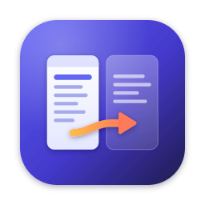

<p align="center">
  
</p>

<h1 align="center">Chojema FileDesk</h1>

<p align="center">A dual-pane file manager for Windows and macOS</p>

<p align="center"><a href="README.md">한국어</a> · <b>English</b></p>

---

## About

Chojema FileDesk is a two-pane file manager. Browse folders with the keyboard and copy or move files from one pane to the other.

## Features

- Side-by-side panes; drag an empty area of the center toolbar to resize (double-click to reset)
- Vertical toolbar between the panes: parent folder, go to top, new folder, copy to other pane, move to other pane, move to Trash, go to bottom, and (at the very bottom) open a terminal in the current folder, and copy the path of selected items, and copy the file/folder list of the active pane
- Quick access to drives, volumes, Home, Desktop, Documents and Downloads
- Sort by name, extension, size or modification date
- Keyboard-first workflow with a function-key bar and type-ahead search
- Copy, move, new folder, rename and move to Trash
- Overwrite All / Skip All when names collide
- Folder size calculation when a folder is selected
- Back/forward history and direct path entry
- Visited folders (last 30) and favorite folders from the path bar
- Show/hide hidden items, with separate options for hidden-attribute items and items starting with a dot (eye icon in the path bar, `Ctrl/⌘` + `.`, View menu, Settings)
- Korean and English interface
- Light, dark or system theme

## Center toolbar

The vertical toolbar between the panes acts on the active pane (the one with the highlighted border).

| Button | Action | Same as |
| --- | --- | --- |
| Parent Folder | Go up one folder | `Backspace` (macOS: `⌘` + `↑`) |
| Go to Top | Move to the first item | `Home` |
| New Folder | Create a folder in the current folder | `F7` |
| Copy | Copy selected items to the other pane's folder | `F5` |
| Move | Move selected items to the other pane's folder | `F6` |
| Delete | Move selected items to the Trash | `F8` |
| Go to Bottom | Move to the last item | `End` |
| Terminal (bottom of the toolbar) | Open a terminal in the active pane's current folder: Windows Terminal (or Command Prompt) on Windows, Terminal on macOS | File menu |
| Copy Path (bottom of the toolbar) | Copy the full path of the selected files/folders to the clipboard, one per line; with no selection, the item under the cursor; on `..`, the current folder | `Ctrl/⌘` + `Shift` + `C` |
| Copy List (bottom of the toolbar) | Copy the names of all files and folders listed in the active pane, one per line in display order; items hidden by the hidden-item settings are left out | File menu |

The copy and move arrows always point from the active pane toward the other pane. With nothing selected, the item under the cursor is used.

## Visited folders and favorites

Two buttons sit at the right of each pane's path bar.

| Button | Action | Shortcut |
| --- | --- | --- |
| Clock (Visited Folders) | The last 30 folders you opened, newest first, shared by both panes. **Clear History** at the bottom empties it. | `Alt` + `↓` (macOS: `⌥` + `↓`) |
| Star (Favorite Folders) | Your favorite folders. The top entry adds or removes the current folder. The star is filled when the current folder is a favorite. | `Ctrl/⌘` + `D` |

In the list, choose with `↑` `↓` and open with `Enter`. Remove an entry with `Delete` or the `×` on its right, and close with `Esc`.

## Hidden items

Under **Hidden items** in Settings (`F10`) you can switch two kinds of items on and off separately.

| Setting | Applies to |
| --- | --- |
| Show files and folders with the hidden attribute | Items with the hidden attribute on Windows, or the hidden flag on macOS (e.g. `~/Library`) |
| Show files and folders starting with a dot (.) | Items such as `.git`, `.env`, `.DS_Store` |

The eye icon at the right of the path bar, or `Ctrl/⌘` + `.`, turns both on or off at once. The View menu toggles each one. The number of hidden items appears in the pane's status bar.

## Keyboard shortcuts

| Key | Action |
| --- | --- |
| `Tab` | Switch pane |
| `Enter` | Open folder / open file with its default app |
| `Backspace` | Parent folder |
| `Space` | Toggle selection |
| `Insert` | Toggle selection and move down |
| `Shift` + arrows | Range selection |
| `Ctrl/⌘` + `A` | Select all |
| `F2` | Rename |
| `F3` | Open |
| `F5` | Copy to other pane |
| `F6` | Move to other pane |
| `F7` | New folder |
| `F8` / `Delete` / `⌘` + `Backspace` | Move to Trash |
| `F10` / `Ctrl/⌘` + `,` | Settings |
| `Ctrl/⌘` + `R` | Refresh |
| `Ctrl/⌘` + `L` | Edit path |
| `Alt` + `↓` | Visited folders |
| `Ctrl/⌘` + `D` | Favorite folders |
| `Ctrl/⌘` + `Shift` + `C` | Copy path of selected items |
| `Ctrl/⌘` + `.` | Show / hide all hidden items |
| `Ctrl/⌘` + `U` | Swap panes |
| `Ctrl/⌘` + `=` | Same folder in other pane |
| `Alt` + `←/→` (macOS: `⌘` + `[` / `]`) | Back / forward |

On macOS, hold `fn` for function keys or click the function-key bar at the bottom of the window.

## Installation

Download the file for your system from the [Releases](../../releases) page.

| System | File |
| --- | --- |
| Windows (installer) | `Chojema-FileDesk-<version>-win-x64-setup.exe` (`arm64` for ARM PCs) |
| Windows (portable) | `Chojema-FileDesk-<version>-win-x64-portable.exe` |
| macOS (Apple Silicon) | `Chojema-FileDesk-<version>-mac-arm64.dmg` |
| macOS (Intel) | `Chojema-FileDesk-<version>-mac-x64.dmg` |

### First launch

The app is not signed with a commercial code-signing certificate, so you may see a warning the first time.

- **Windows**: when "Windows protected your PC" appears, click **More info** → **Run anyway**.
- **macOS**: if the app is blocked, open **System Settings** → **Privacy & Security** and click **Open Anyway**.

## Privacy

- Chojema FileDesk collects no data and sends nothing anywhere. It makes no network connections.
- Settings (language, theme, last opened folders, visited folders, favorites, etc.) are stored only on your computer. Clear the visited-folder history with **Clear History** in that list. Location:
  - Windows: `%APPDATA%\Chojema FileDesk\settings.json`
  - macOS: `~/Library/Application Support/Chojema FileDesk/settings.json`
- Deleting moves items to the system Trash, so they can be restored.

## Building from source

Requirements: [Node.js](https://nodejs.org/) 22 or later

```bash
npm install
npm run dev        # run in development mode
npm run build      # build the app code
npm run typecheck  # type check
```

### Packaging (Windows and macOS, both from a Mac)

```bash
npm run dist:mac   # .dmg and .zip in dist/
npm run dist:win   # .exe installer and portable build in dist/
npm run dist:all   # both
```

- macOS builds use an ad-hoc signature. If you have an Apple Developer ID certificate, set it with the `CSC_NAME` environment variable.
- If the Windows build fails on macOS while editing the executable's icon/version resources, install Wine and retry (`brew install --cask wine-stable`).

### Icon

The icon source is `build/icon-art.svg`. Regenerate the PNGs after editing:

```bash
npm run icons
```

## Versioning and releases

Versions follow [Semantic Versioning](https://semver.org/) `MAJOR.MINOR.PATCH`, with `version` in `package.json` as the single source.

```bash
# 1. Bump the version and create Korean/English release-note drafts
npm run release:prepare -- patch     # or minor, major, 1.2.3

# 2. Write release-notes/v<version>.md and v<version>.en.md

# 3. Build the packages
npm run dist:all

# 4. Create the GitHub release body (Korean + English)
npm run release:notes
```

Use the `git tag` / `gh release create` commands printed by the last step to publish on GitHub.

- Changelog: [CHANGELOG.en.md](CHANGELOG.en.md)
- Release notes: [release-notes/](release-notes/)

## License

[MIT](LICENSE) © 2026 Chulwoo Park
