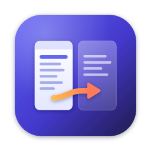

<p align="center">
  
</p>

<h1 align="center">Chojema FileDesk</h1>

<p align="center">Windows와 macOS를 위한 좌우 분할형 파일 관리자</p>

<p align="center"><b>한국어</b> · <a href="README.en.md">English</a></p>

---

## 소개

Chojema FileDesk는 두 개의 패널을 나란히 놓고 파일을 다루는 2패널 파일 관리자입니다. 키보드만으로 폴더를 이동하고, 한쪽 패널의 파일을 반대쪽 패널로 복사하거나 옮길 수 있습니다.

## 주요 기능

- 좌우 2패널 구성, 패널 너비 조절(가운데 도구 모음의 빈 곳을 드래그, 더블클릭하면 원래대로)
- 두 패널 사이의 세로 도구 모음: 상위 폴더, 맨 위로, 새 폴더, 반대쪽으로 복사, 반대쪽으로 이동, 휴지통으로 이동, 맨 아래로, (맨 아래) 현재 폴더에서 터미널 열기, 선택한 항목의 경로 복사, 현재 창의 파일·폴더 목록 복사
- 드라이브·볼륨·홈·데스크톱·문서·다운로드 바로가기
- 이름·확장자·크기·수정한 날짜 정렬
- 키보드 중심 조작(펑션 키 바, 빠른 이름 찾기)
- 복사·이동·새 폴더·이름 바꾸기·휴지통으로 이동
- 같은 이름이 있을 때 모두 덮어쓰기 / 모두 건너뛰기 선택
- 폴더 선택 시 폴더 크기 계산
- 뒤로·앞으로 이동 기록, 경로 직접 입력
- 경로 표시줄의 방문했던 폴더(최근 30곳) / 즐겨찾기 폴더 목록
- 숨김 항목 표시/감추기: 숨김 속성 파일·폴더와 점(.)으로 시작하는 파일·폴더를 각각 설정 (경로 표시줄의 눈 아이콘, `Ctrl/⌘` + `.`, 보기 메뉴, 설정)
- 한국어 / 영어 인터페이스
- 밝은 테마 / 어두운 테마 / 시스템 설정 따르기

## 가운데 도구 모음

두 패널 사이의 세로 도구 모음 버튼은 현재 선택된(테두리가 강조된) 패널에 적용됩니다.

| 버튼 | 동작 | 같은 키 |
| --- | --- | --- |
| 상위 폴더 | 한 단계 위 폴더로 이동 | `Backspace` (macOS: `⌘` + `↑`) |
| 맨 위로 | 목록의 첫 항목으로 이동 | `Home` |
| 새 폴더 | 현재 폴더에 새 폴더 만들기 | `F7` |
| 복사 | 선택한 항목을 반대쪽 패널 폴더로 복사 | `F5` |
| 이동 | 선택한 항목을 반대쪽 패널 폴더로 이동 | `F6` |
| 삭제 | 선택한 항목을 휴지통으로 이동 | `F8` |
| 맨 아래로 | 목록의 마지막 항목으로 이동 | `End` |
| 터미널 (도구 모음 맨 아래) | 선택된 패널의 현재 폴더에서 터미널 열기. Windows는 Windows Terminal(없으면 명령 프롬프트), macOS는 터미널 앱 | 파일 메뉴 |
| 경로 복사 (도구 모음 맨 아래) | 선택한 파일·폴더의 전체 경로를 클립보드에 복사. 여러 개면 한 줄에 하나씩, 선택이 없으면 커서 항목, 커서가 `..`이면 현재 폴더 | `Ctrl/⌘` + `Shift` + `C` |
| 목록 복사 (도구 모음 맨 아래) | 선택된 패널에 보이는 파일·폴더 이름 전체를 화면 순서대로 한 줄에 하나씩 복사. 숨김 설정으로 감춰진 항목은 제외 | 파일 메뉴 |

복사·이동 버튼의 화살표는 항상 선택된 패널에서 반대쪽 패널을 가리킵니다. 선택한 항목이 없으면 커서가 있는 항목에 적용됩니다.

## 방문했던 폴더와 즐겨찾기

각 패널의 경로 표시줄 오른쪽에 두 버튼이 있습니다.

| 버튼 | 동작 | 단축키 |
| --- | --- | --- |
| 시계 (방문했던 폴더) | 최근에 연 폴더 30곳을 최신순으로 보여 줍니다. 두 패널이 같은 기록을 씁니다. 맨 아래 **방문 기록 지우기**로 비울 수 있습니다. | `Alt` + `↓` (macOS: `⌥` + `↓`) |
| 별 (즐겨찾기 폴더) | 즐겨찾기한 폴더 목록. 맨 위 항목으로 현재 폴더를 추가하거나 제거합니다. 현재 폴더가 즐겨찾기면 별이 채워집니다. | `Ctrl/⌘` + `D` |

목록에서는 `↑` `↓`로 고르고 `Enter`로 엽니다. `Delete` 키나 항목 오른쪽의 `×`로 목록에서 지울 수 있고, `Esc`로 닫습니다.

## 숨김 항목

설정(`F10`)의 **숨김 항목**에서 두 가지를 따로 켜고 끌 수 있습니다.

| 설정 | 대상 |
| --- | --- |
| 숨김 속성 파일·폴더 표시 | Windows에서 숨김 속성이 있는 항목, macOS에서 숨김 플래그가 있는 항목(예: `~/Library`) |
| 점(.)으로 시작하는 파일·폴더 표시 | `.git`, `.env`, `.DS_Store` 같은 항목 |

경로 표시줄 오른쪽의 눈 아이콘이나 `Ctrl/⌘` + `.`을 누르면 두 설정을 한꺼번에 켜거나 끕니다. 보기 메뉴에서는 하나씩 바꿀 수 있습니다. 숨겨진 항목 수는 패널 아래 상태 표시줄에 나옵니다.

## 단축키

| 키 | 동작 |
| --- | --- |
| `Tab` | 패널 전환 |
| `Enter` | 폴더 열기 / 파일을 기본 앱으로 열기 |
| `Backspace` | 상위 폴더 |
| `Space` | 선택 토글 |
| `Insert` | 선택 토글 후 다음 항목 |
| `Shift` + 방향키 | 범위 선택 |
| `Ctrl/⌘` + `A` | 모두 선택 |
| `F2` | 이름 바꾸기 |
| `F3` | 열기 |
| `F5` | 반대쪽 패널로 복사 |
| `F6` | 반대쪽 패널로 이동 |
| `F7` | 새 폴더 |
| `F8` / `Delete` / `⌘` + `Backspace` | 휴지통으로 이동 |
| `F10` / `Ctrl/⌘` + `,` | 설정 |
| `Ctrl/⌘` + `R` | 새로 고침 |
| `Ctrl/⌘` + `L` | 경로 입력 |
| `Alt` + `↓` | 방문했던 폴더 |
| `Ctrl/⌘` + `D` | 즐겨찾기 폴더 |
| `Ctrl/⌘` + `Shift` + `C` | 선택한 항목의 경로 복사 |
| `Ctrl/⌘` + `.` | 숨김 항목 모두 표시 / 감추기 |
| `Ctrl/⌘` + `U` | 좌우 패널 바꾸기 |
| `Ctrl/⌘` + `=` | 반대쪽 패널을 같은 폴더로 |
| `Alt` + `←/→` (macOS: `⌘` + `[` / `]`) | 뒤로 / 앞으로 |

macOS에서 펑션 키를 쓰려면 `fn` 키를 함께 누르거나, 화면 아래의 펑션 키 바를 클릭하세요.

## 설치

[Releases](../../releases) 페이지에서 운영체제에 맞는 파일을 내려받습니다.

| 운영체제 | 파일 |
| --- | --- |
| Windows (설치형) | `Chojema-FileDesk-<버전>-win-x64-setup.exe` (ARM PC는 `arm64`) |
| Windows (설치 없이 실행) | `Chojema-FileDesk-<버전>-win-x64-portable.exe` |
| macOS (Apple Silicon) | `Chojema-FileDesk-<버전>-mac-arm64.dmg` |
| macOS (Intel) | `Chojema-FileDesk-<버전>-mac-x64.dmg` |

### 처음 실행할 때

이 앱은 상용 코드 서명 인증서로 서명되어 있지 않아 처음 실행할 때 경고가 나타날 수 있습니다.

- **Windows**: "Windows의 PC 보호" 창이 나타나면 **추가 정보** → **실행**을 누릅니다.
- **macOS**: 앱을 처음 열 때 차단되면 **시스템 설정** → **개인정보 보호 및 보안**에서 **그래도 열기**를 누릅니다.

## 개인정보

- Chojema FileDesk는 어떤 데이터도 수집하거나 외부로 전송하지 않습니다. 네트워크 통신을 하지 않습니다.
- 설정(언어, 테마, 마지막으로 연 폴더, 방문했던 폴더, 즐겨찾기 등)은 사용자의 컴퓨터에만 저장됩니다. 방문 기록은 방문했던 폴더 목록의 **방문 기록 지우기**로 지울 수 있습니다.
  - Windows: `%APPDATA%\Chojema FileDesk\settings.json`
  - macOS: `~/Library/Application Support/Chojema FileDesk/settings.json`
- 삭제하면 운영체제의 휴지통으로 이동하므로 휴지통에서 되살릴 수 있습니다.

## 소스에서 빌드하기

필요한 것: [Node.js](https://nodejs.org/) 22 이상

```bash
npm install
npm run dev        # 개발 모드로 실행
npm run build      # 앱 코드 빌드
npm run typecheck  # 타입 검사
```

### 배포 파일 만들기 (macOS에서 Windows·macOS 모두)

```bash
npm run dist:mac   # dist/ 에 .dmg, .zip 생성
npm run dist:win   # dist/ 에 .exe 설치 파일과 포터블 파일 생성
npm run dist:all   # 둘 다
```

- macOS 빌드는 임시(ad-hoc) 서명을 사용합니다. Apple Developer ID 인증서가 있으면 환경 변수 `CSC_NAME`으로 지정할 수 있습니다.
- macOS에서 Windows를 빌드하다가 실행 파일 아이콘·버전 정보 편집 단계에서 오류가 나면 Wine을 설치한 뒤 다시 시도하세요(`brew install --cask wine-stable`).

### 아이콘

아이콘 원본은 `build/icon-art.svg`입니다. 수정한 뒤 다음 명령으로 PNG를 다시 만듭니다.

```bash
npm run icons
```

## 버전 관리와 릴리스

버전은 [유의적 버전(SemVer)](https://semver.org/lang/ko/) `주.부.수` 형식을 따르며 `package.json`의 `version` 하나로 관리합니다.

```bash
# 1. 버전 올리기 + 릴리스 노트 초안(한국어/영어) 만들기
npm run release:prepare -- patch     # 또는 minor, major, 1.2.3

# 2. release-notes/v<버전>.md, v<버전>.en.md 작성

# 3. 배포 파일 빌드
npm run dist:all

# 4. GitHub 릴리스 본문 만들기 (한국어 + 영어)
npm run release:notes
```

마지막 명령이 출력하는 `git tag` / `gh release create` 명령으로 GitHub에 릴리스를 올립니다.

- 변경 기록: [CHANGELOG.md](CHANGELOG.md)
- 릴리스 노트: [release-notes/](release-notes/)

## 라이선스

[MIT](LICENSE) © 2026 Chulwoo Park
